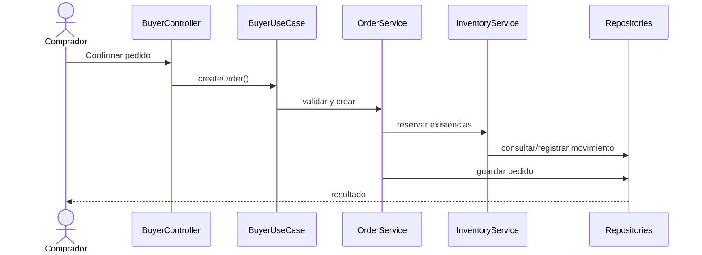

# C4 Nivel 4 — Código

## Clases principales
`User`, `Buyer`, `Seller`, `Warehouse`, `Product`, `Inventory`, `Cart`, `CartItem`, `Order`, `Invoice`, `Shipment`, `ReturnRequest`, `Refund`.

## Flujo de ejemplo

La confirmación de pago y sus integraciones requieren definición adicional.
